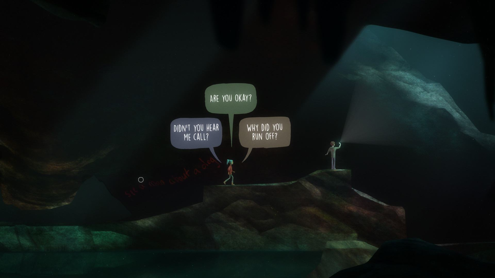
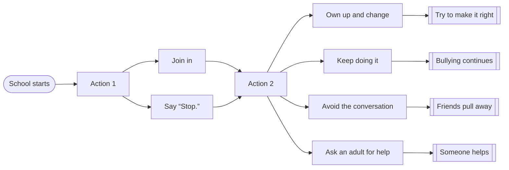

# Find the Bully

> **A story where you become the bully, victim or bystander based on your choices.**

You play as a teenager exploring school with two friends.
What you say and do changes the story.

*Prabu Dhinakar*

---

## 01 · Plot

# Find the Bully

### A story where you become the bully, victim or bystander based on your choices.

You play as a teenager exploring school with two friends.
What you say and do changes the story.

---

## 02 · WHY IT MATTERS

# Why I want to make this

| WHAT WE ARE TOLD | WHAT CAN HAPPEN |
| :--- | :--- |
| We know bullying is wrong. | **Experience bullying from different perspectives to build awareness.** |

| BULLYING AND PEER PRESSURE | FOR TEENS |
| :--- | :--- |
| Let players see the harm they cause. | Also for discussions at school. |

---

## 03 · OXENFREE / INTERACTION REFERENCE

# How Oxenfree's dialogue works

**OXENFREE / HOW IT WORKS**

- Keep walking while talking.
- Replies don't stay forever.
- The story matters. Players see themselves in the characters and connect with them.

> No reply before time runs out = silence.

*OXENFREE · Night School Studio · reference screenshot*

---

## 04 · BRANCHING STORY / MULTIPLE ENDINGS

# How the story branches

| 01 / MORNING | 02 / HALLWAY | 03 / LUNCH | 04 / WHAT YOU DO NEXT | POSSIBLE ENDINGS |
| :--- | :--- | :--- | :--- | :--- |
| School starts | Action 1: Join in / Say "Stop." | Action 2 | **Own up and change** | **Try to make it right** |
| | | | Keep doing it | Bullying continues |
| | | | Avoid the conversation | Friends pull away |
| | | | Ask an adult for help | Someone helps |

---

## 05 · THE CLIMAX / SEE YOUR IMPACT

# What you see at the end

> **Who are you: a bully, a victim or a bystander?**

| Why did you do it? | What went wrong? | What could you have done instead? |
| :--- | :--- | :--- |
| You wanted to fit in. | You kept making the joke. It hurt someone. | Stop the joke. Listen to the person you hurt. |

- If you were bullied: support, not blame.
- If you watched: what could you have done?

> **Knowing why doesn't make it okay.**
> **Saying sorry doesn't fix everything.**

---

## 06 · IMPACT + INVITATION

# I want players to think about it.

> *How did I hurt someone? What could I have done differently? How can I make it right?*

**HOW I WANT PLAYERS TO FEEL**

- Curious
- Involved
- Uneasy
- I get it
- Thinking

---

*Find the Bully · Prabu Dhinakar*
